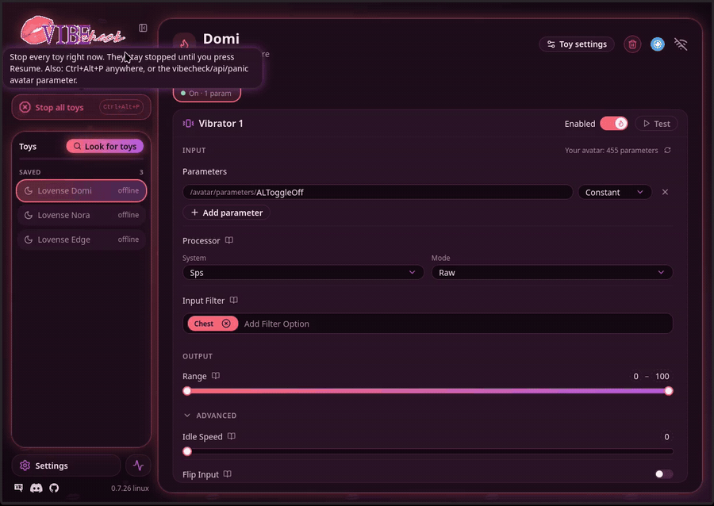
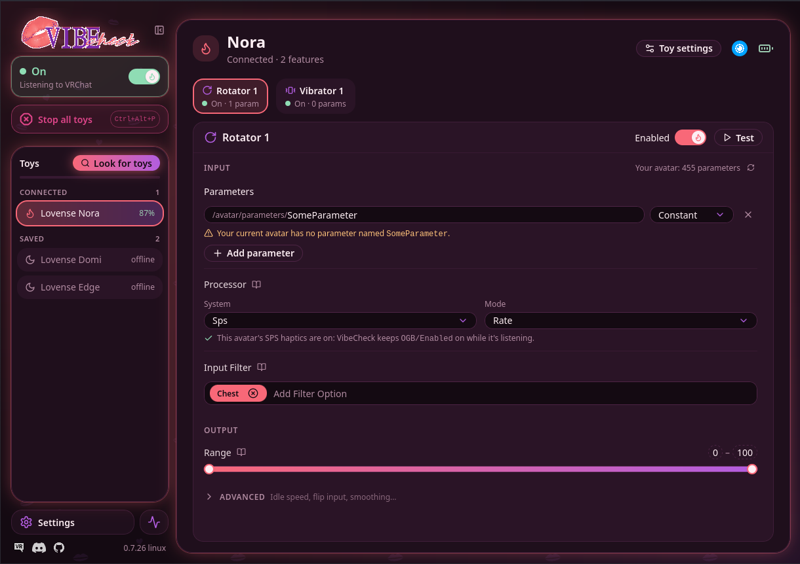
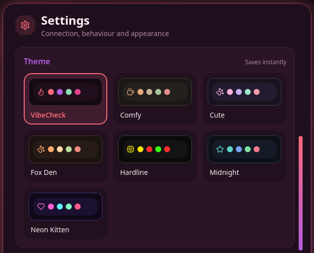

  

  <b>Connect Bluetooth sex toys to your VRChat avatar using VRChat's OSC.</b>

  
  
  

  <a href="https://github.com/SutekhVRC/VibeCheck/releases/latest"><b>Download</b></a>
  &nbsp;·&nbsp;
  <a href="https://github.com/SutekhVRC/VibeCheck/wiki"><b>Wiki</b></a>
  &nbsp;·&nbsp;
  <a href="https://discord.gg/C8ACSGSyfq"><b>Discord</b></a>
  &nbsp;·&nbsp;
  <a href="https://github.com/SutekhVRC/VibeCheck/issues"><b>Report a bug</b></a>

  

  <b>Avatar gets touched</b> &nbsp;→&nbsp; <b>VRChat sends it over OSC</b> &nbsp;→&nbsp; <b>VibeCheck</b> &nbsp;→&nbsp; <b>your toy reacts</b>

---

## Why VibeCheck

- **Nothing in between, so lower latency.** [Buttplug.io](https://buttplug.io/) is built in: VibeCheck talks to your toys over Bluetooth itself, so every command goes straight to the toy instead of through another app, and there's nothing extra to start. Works with [hundreds of toys](https://iostindex.com/?filter0ButtplugSupport=4).
- **Intiface Central works too.** Prefer it, or no Bluetooth on your PC? Connect through [Intiface Central](https://github.com/SutekhVRC/VibeCheck/wiki/Intiface-Central) on your computer or phone instead.
- **SPS and TPS built in.** SPS 3, older SPS (even mixed) and TPS, with depth, touch and frot. Or drive toys from any avatar parameter you like.
- **Sets itself up with VRChat.** Finds VRChat over OSCQuery on its own port, so it runs alongside your other OSC apps.
- **Safe by design.** A panic stop that is always one press away (button, **Ctrl + Alt + P**, tray or avatar menu) and a master intensity for every toy.
- **Windows and Linux,** with in-app updates on both.

## Getting started

1. **Get a toy** that [Buttplug.io supports](https://iostindex.com/?filter0ButtplugSupport=4) and [connect it](https://github.com/SutekhVRC/VibeCheck/wiki/Connecting-Toys).
2. **Install VibeCheck** from the [latest release](https://github.com/SutekhVRC/VibeCheck/releases/latest): the installer on Windows, or the AppImage, `.deb` or `.rpm` on Linux.
3. **Set up your avatar** with SPS, TPS or your own contacts: [Avatar Setup](https://github.com/SutekhVRC/VibeCheck/wiki/Avatar-Setup).
4. **Turn VibeCheck on and look for toys.** The [App Setup](https://github.com/SutekhVRC/VibeCheck/wiki/VibeCheck-App-Setup) guide walks you through the rest.

## Features

  

- **Per-motor tuning:** output range, idle speed, flip input, and Smooth, Rate and Constant modes. Rate follows how fast you stroke.
- **Input filters** choose which sockets or plugs drive each toy.
- **In-game control** with the [OSC API](https://github.com/SutekhVRC/VibeCheck/wiki/Advanced-Features): turn VibeCheck on or off, panic stop, and switch toys by anatomy from your avatar menu.
- **Battery levels** sent back to VRChat for your avatar to show.
- **Live diagnostics:** see every parameter VRChat sends and what each toy makes of it, without a separate OSC tool.
- **Themes,** a tray menu with live status, scanning again when a toy drops, and desktop notifications.

  

## Documentation

All guides live on the [wiki](https://github.com/SutekhVRC/VibeCheck/wiki):

| Guide | What it covers |
|---|---|
| [App Setup](https://github.com/SutekhVRC/VibeCheck/wiki/VibeCheck-App-Setup) | A tour of the app and first-time setup |
| [Connecting Toys](https://github.com/SutekhVRC/VibeCheck/wiki/Connecting-Toys) | Bluetooth requirements, finding toys and common Bluetooth issues |
| [Intiface Central](https://github.com/SutekhVRC/VibeCheck/wiki/Intiface-Central) | Using Intiface Central (desktop or phone) instead of this computer's Bluetooth |
| [Avatar Setup](https://github.com/SutekhVRC/VibeCheck/wiki/Avatar-Setup) | OSC, custom setups, SPS and TPS |
| [Toy Options](https://github.com/SutekhVRC/VibeCheck/wiki/Toy-Options-List) | Every per-toy and per-motor setting |
| [Settings](https://github.com/SutekhVRC/VibeCheck/wiki/VibeCheck-Settings) | Every app setting |
| [OSC API](https://github.com/SutekhVRC/VibeCheck/wiki/Advanced-Features) | Parameters to control VibeCheck from inside VRChat |
| [Panic Stop](https://github.com/SutekhVRC/VibeCheck/wiki/Panic-Stop) | Stopping every toy at once |
| [Themes](https://github.com/SutekhVRC/VibeCheck/wiki/Themes) | The app's themes |
| [Diagnostics](https://github.com/SutekhVRC/VibeCheck/wiki/Diagnostics) | Checking what VRChat sends and what your toys make of it |
| [FAQ](https://github.com/SutekhVRC/VibeCheck/wiki/FAQ) | App, connection and avatar configuration issues |

## Community

  
  &nbsp;
  

  Get help, share avatar setups, suggest features and hang out.

Found a bug or have an idea? [Open an issue](https://github.com/SutekhVRC/VibeCheck/issues) or tell us on [Discord](https://discord.gg/C8ACSGSyfq).

## Contributing

VibeCheck is a [Tauri](https://tauri.app/) app with a Rust backend and a React frontend. [CONTRIBUTING.md](./CONTRIBUTING.md) covers building from source, the code layout and testing without VRChat.

## License

VibeCheck is licensed under the [Apache License 2.0](./LICENSE).
