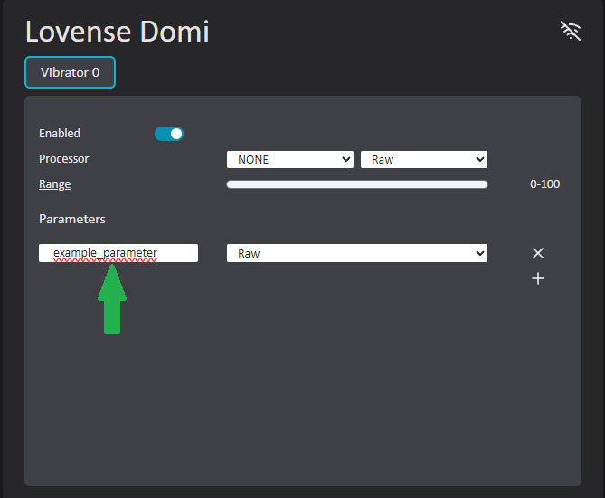

# VibeCheck App Setup

1. Run VibeCheck.
2. If VibeCheck is your only OSC app that receives data from VRChat, skip step 3.
3. If you are using multiple OSC apps that **Receive** data from VRChat consider using my OSC router app: [VOR](https://github.com/SutekhVRC/VOR/releases/latest). Then go to the 'Settings' tab and setup VibeCheck's OSC bind host/port to listen on.
4. Setup connection via [Bluetooth](./Bluetooth.md) and turn on your toy(s).
5. Once your toy(s) are connected, configure them to use the parameters you want them to listen for (Floats only).

6. Once your toy is configured/saved press on switch in the bottom left to start using VibeCheck with VRChat.
7. Once you are in VRChat you will need to enable OSC in the expressions menu. If you have used OSC before with your avatar, remember to refresh the OSC config for that avatar (Click the Refresh OSC button in the VibeCheck settings menu and re-load the avatar).
8. You should be all set now. Enjoyyyyyy ;}

### Enable/Disable OSC command

- VibeCheck listens for the boolean parameter `vibecheck/api/state`. Set to true while VibeCheck is off, it turns VibeCheck on and scans for the scan length set in Settings (30 seconds by default). Set to false while VibeCheck is on, it turns VibeCheck off. Older versions used `vibecheck/state` to turn on; that no longer works.

### Toy Settings (Wrench Icon)

- OSC Data: Click the checkbox to enable a float to be sent to VRChat that is the battery life of the toy. You can use this parameter in your avatar's animation controllers. Click the address bar to copy the parameter.