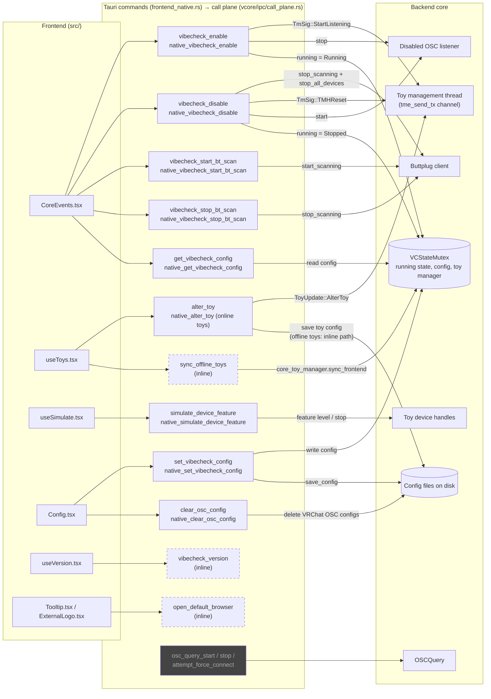

# Command plane: frontend → backend (`invoke`)

Each command box shows the Tauri command name (`src-tauri/src/frontend/frontend_native.rs`)
and, below it, the call plane function it hands off to (`src-tauri/src/vcore/ipc/call_plane.rs`).

- **Dashed boxes** do their work inline in `frontend_native.rs` instead of going through the call plane.
- **Grey boxes** are registered but never called by the frontend.

See also: [emit plane](emit-plane.md), [VRChat enable round trip](enable-round-trip.md).
