# Command plane: frontend → backend (`invoke`)

Each command box shows the Tauri command name (`src-tauri/src/frontend/frontend_native.rs`)
and, below it, what it hands off to: a call plane function (`src-tauri/src/vcore/ipc/call_plane.rs`)
or another module.

- **Dashed boxes** do their work inline in `frontend_native.rs` instead of going through the call plane.
- **Grey boxes** are registered but never called by the frontend.

```mermaid
flowchart LR
  subgraph FE["Frontend (src/)"]
    CE["CoreEvents.tsx"]
    UT["useToys.tsx"]
    US["useSimulate.tsx"]
    CF["Config.tsx"]
    TC["ToyConnection.tsx"]
    AC["AvatarCatalog.tsx"]
    DG["useDiagnostics.ts"]
    UV["useVersion.tsx / useUpdate.tsx"]
    TL["Tooltip.tsx / ExternalLogo.tsx"]
  end

  subgraph CMD["Tauri commands (frontend_native.rs) → what they call"]
    c_en["vibecheck_enable<br/>native_vibecheck_enable"]
    c_dis["vibecheck_disable<br/>native_vibecheck_disable"]
    c_ss["vibecheck_start_bt_scan<br/>native_vibecheck_start_bt_scan"]
    c_st["vibecheck_stop_bt_scan<br/>native_vibecheck_stop_bt_scan"]
    c_gc["get_vibecheck_config<br/>native_get_vibecheck_config"]
    c_sc["set_vibecheck_config<br/>native_set_vibecheck_config"]
    c_rc["reset_vibecheck_config<br/>native_reset_vibecheck_config"]
    c_gtc["get_toy_connection<br/>native_get_toy_connection"]
    c_stc["set_toy_connection<br/>native_set_toy_connection"]
    c_at["alter_toy<br/>native_alter_toy (online toys)"]
    c_sim["simulate_device_feature<br/>native_simulate_device_feature"]
    c_simo["simulate_feature_osc_input<br/>native_simulate_feature_osc_input"]
    c_clr["clear_osc_config<br/>native_clear_osc_config"]
    c_sync["sync_offline_toys<br/>(inline)"]
    c_rm["remove_offline_toy<br/>(inline)"]
    c_ps["panic_stop / panic_resume<br/>get_panic_state<br/>vcore/panic.rs"]
    c_dg["set_diagnostics_enabled<br/>(inline)"]
    c_gac["get_avatar_catalog<br/>refresh_avatar_catalog<br/>(inline)"]
    c_chk["check_feature<br/>avatar_catalog::check_feature"]
    c_log["open_log_folder<br/>(inline)"]
    c_ver["vibecheck_version<br/>vibecheck_updater_enabled<br/>(inline)"]
    c_br["open_default_browser<br/>(inline)"]
    c_oq["get_oscquery_status<br/>native_get_oscquery_status"]
  end

  subgraph CORE["Backend core"]
    ST[("VCStateMutex<br/>running state, config, toy manager")]
    BP["Buttplug client"]
    TS["Toy service<br/>(util/toy_service.rs)"]
    TM["Toy management thread<br/>(tme_send_tx channel)"]
    DL["Disabled OSC listener"]
    FS[("Config files on disk")]
    DH["Toy device handles"]
    OQ["OSCQuery mode<br/>(osc/oscquery.rs)"]
    SL["Safety layer<br/>(panic stop)"]
    DI["Diagnostics"]
    CAT["Avatar catalog<br/>(osc/avatar_catalog.rs)"]
    LOG[("Log folder")]
  end

  CE --> c_en & c_dis & c_ss & c_st & c_gc & c_ps
  CF --> c_sc & c_rc & c_clr & c_oq & c_log
  TC --> c_gtc & c_stc
  UT --> c_at & c_sync & c_rm
  US --> c_sim
  AC --> c_gac & c_chk
  DG --> c_dg
  UV --> c_ver
  TL --> c_br

  c_en -- "TmSig::StartListening" --> TM
  c_en -- "stop" --> DL
  c_en -- "running = Running" --> ST
  c_dis -- "stop_scanning + stop_all_devices" --> BP
  c_dis -- "TmSig::TMHReset" --> TM
  c_dis -- "start" --> DL
  c_dis -- "running = Stopped" --> ST
  c_ss -- "start_scanning, stop after<br/>the scan length" --> BP
  c_st -- "stop_scanning" --> BP
  c_gc -- "read config" --> ST
  c_sc -- "write config" --> ST
  c_sc -- "save_config" --> FS
  c_gtc -- "status" --> TS
  c_stc -- "save, reconnect" --> TS
  c_at -- "ToyUpdate::AlterToy" --> TM
  c_at -- "save toy config<br/>(offline toys: inline path)" --> FS
  c_sim -- "feature level / stop" --> DH
  c_simo -- "an OSC packet to<br/>its own listen port" --> TM
  c_clr -- "delete VRChat OSC configs" --> FS
  c_sync -- "core_toy_manager.sync_frontend" --> ST
  c_rm -- "remove_offline_toy:<br/>refused while connected" --> ST
  c_rm -- "delete ToyConfigs files<br/>with that toy_name" --> FS
  c_rc -- "defaults, keeping oscquery_port" --> ST
  c_rc -- "save_config" --> FS
  c_rc -- "listen change: apply_oscquery,<br/>restart off listener" --> OQ
  c_sc -- "mode change: apply_oscquery,<br/>restart off listener" --> OQ
  c_oq -- "status: port, VRChat found" --> OQ
  c_ps -- "panic / resume" --> SL
  c_dg -- "on / off" --> DI
  c_gac -- "current avatar,<br/>read again now" --> CAT
  c_chk -- "compare one feature<br/>with the avatar" --> CAT
  c_log -- "open in the file manager" --> LOG

  classDef inline stroke-dasharray: 5 5
  classDef unused fill:#444,color:#aaa
  class c_sync,c_rm,c_ver,c_br,c_dg,c_gac,c_log inline
  class c_simo unused
```

## Where commands run

A command declared as a plain `fn` with `#[tauri::command]` runs on the
**main thread**, which also runs the window and the tray menu: while it
runs (or waits for a lock), the window can't respond. So every command in
`frontend_native.rs` is `#[tauri::command(async)]`, which runs it in a task
on Tauri's async runtime instead.

- **Blocking on async work:** `vibecheck_enable`, `vibecheck_disable`,
  `vibecheck_start_bt_scan` and `vibecheck_stop_bt_scan` wait for their
  call plane function with `run_blocking`, which hands the worker thread
  over (`block_in_place`) before `block_on`: a plain `block_on` inside a
  runtime task panics.
- **The state lock:** most commands lock `VCStateMutex`, and those four hold
  it while they wait on the toy service and Buttplug. Other commands then
  wait for it on a worker thread, not on the main thread, so the window
  stays responsive.
- **New commands** should be `#[tauri::command(async)]` (or `async fn`) too,
  and so should commands an app adds through `Extensions::commands`
  (`src/extensions.rs`).

See also: [emit plane](emit-plane.md), [VRChat enable round trip](enable-round-trip.md).
