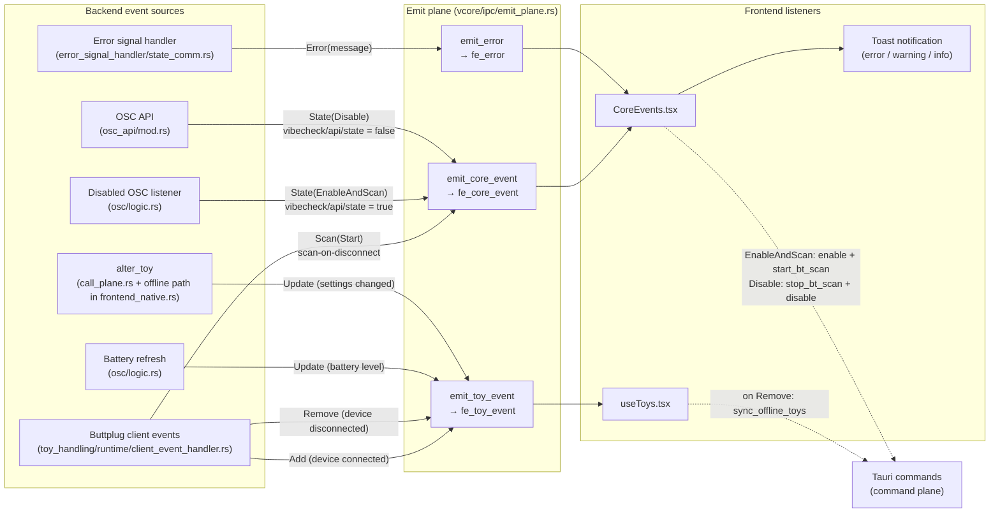

# Emit plane: backend → frontend (events)

All events go out through `src-tauri/src/vcore/ipc/emit_plane.rs`. The frontend
event names live in `LISTEN` in `src/data/constants.ts`.

The dotted arrows on the right show the frontend calling back into the
[command plane](command-plane.md) in response to an event.

## Event payloads

| Event | Rust type | Variants |
|---|---|---|
| `fe_toy_event` | `FeToyEvent` | `Add(FeVCToy)`, `Remove(u32)`, `Update(FeVCToy)` |
| `fe_core_event` | `FeCoreEvent` | `Scan(Start)`, `State(EnableAndScan \| Disable)` |
| `fe_error` | `FrontendError` | `Error(String)`, `Warning(String)`, `Info(String)` |

See also: [command plane](command-plane.md), [VRChat enable round trip](enable-round-trip.md).
