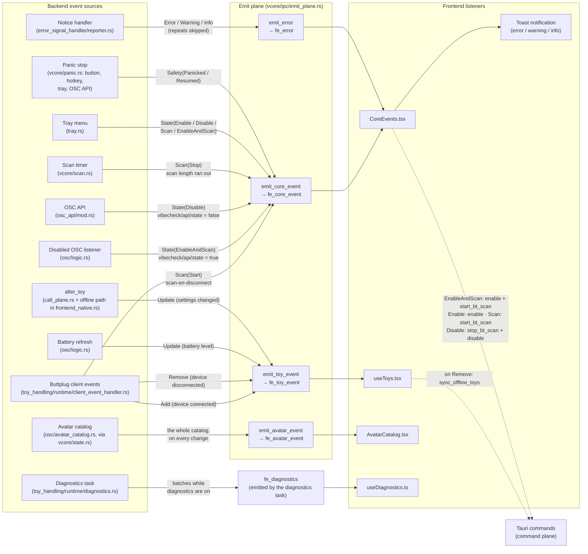

# Emit plane: backend → frontend (events)

Events go out through `src-tauri/src/vcore/ipc/emit_plane.rs`, except
diagnostics batches, which `toy_handling/runtime/diagnostics.rs` emits
itself. The frontend event names live in `LISTEN` in `src/data/constants.ts`.

The dotted arrows on the right show the frontend calling back into the
[command plane](command-plane.md) in response to an event.

## Event payloads

| Event | Rust type | Variants or contents |
|---|---|---|
| `fe_toy_event` | `FeToyEvent` | `Add(FeVCToy)`, `Remove(u32)`, `Update(FeVCToy)` |
| `fe_core_event` | `FeCoreEvent` | `Scan(Start \| Stop)`, `State(EnableAndScan \| Disable \| Enable \| Scan)`, `Safety(Panicked \| Resumed)` |
| `fe_error` | `FrontendError` | `Error(String)`, `Warning(String)`, `Info(String)` |
| `fe_avatar_event` | `FeAvatarCatalog` | `status`, `parameters`, `zones` (the avatar's SPS zones), `tps` |
| `fe_diagnostics` | `FeDiagnostics` | `reset`, changed `signals`, every toy's graph values (`toys`), new `log` entries |

- `fe_error` carries problems found by background work; see [Errors](../runtime/errors.md).
- `fe_avatar_event` is sent whenever the catalog changes; `get_avatar_catalog` returns the same thing on demand. See [Avatar catalog](../runtime/toy-command-path.md#avatar-catalog).
- `fe_diagnostics` is only sent while the diagnostics view has turned diagnostics on (`set_diagnostics_enabled`).

Desktop notifications (a toy connecting, or an app's own through
`SessionContext::notify`) aren't events: they go to the system directly,
and only while Settings > Desktop notifications is on.

See also: [command plane](command-plane.md), [VRChat enable round trip](enable-round-trip.md).
