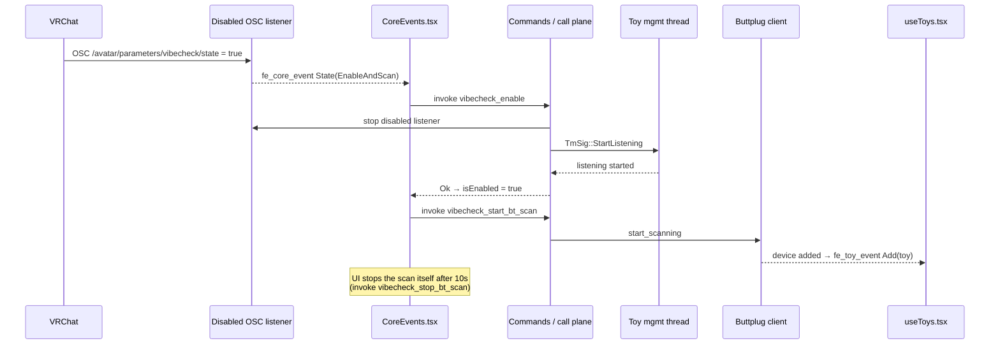

# Example round trip: VRChat turns VibeCheck on

The two IPC planes form a loop. The backend never enables itself: it asks the
UI to do it through the [emit plane](emit-plane.md), and the UI calls back in
through the [command plane](command-plane.md).

