# Toy command path: OSC message → toy motor

How an avatar parameter from VRChat ends up as a Bluetooth command, while VibeCheck is on.

```mermaid
flowchart LR
  VRC[["VRChat"]] -- "UDP OSC" --> IN["OscInput<br/>(vibecheck-core)"]

  IN -- "/avatar/change<br/>AvatarChange event" --> EV["core_event_handler<br/>runtime/osc_routing.rs<br/>stops all toys"]
  IN -- "every other message<br/>(tap, in order)" --> RT["osc_router<br/>runtime/osc_routing.rs"]
  RT -- "vibecheck/api/..." --> API["handle_api_message<br/>osc_api/mod.rs"]
  RT -- "only to toys that use<br/>the address" --> TT
  CFG["alter_toy<br/>(toy management handler)"] -- "control channel<br/>(applied first)" --> TT

  subgraph TT["Toy task (one per connected toy)<br/>runtime/toy_management_handler.rs"]
    direction TB
    PARSE["parse_osc_message<br/>osc_processor.rs<br/>SPS/TPS · Raw/Smooth/Rate/Constant"]
    SINK["ToyCommandSink::send<br/>runtime/toy_output.rs"]
    LT["clamp_and_flip<br/>Idle · Range · Flip Input"]
    SAFE["SafetyLayer::clamp<br/>(vibecheck-core)"]
    PARSE --> SINK --> LT --> SAFE
  end

  SAFE -- "ClampedCmd" --> SLOTS[("CommandSlots<br/>one latest command<br/>per motor")]

  subgraph EM["Emitter task (one per toy)<br/>runtime/toy_emitter_thread.rs"]
    TICK["every 1 / Update Rate:<br/>take_changed()"]
  end

  SLOTS --> TICK
  TICK -- "changed commands" --> BP["ButtplugOutput::apply<br/>(vibecheck-core)"]
  BP -- "scalar / rotate / linear" --> TOY[["Toy (Bluetooth)"]]
```

## Step by step

1. **`OscInput`** (`vibecheck-core/src/modules/osc.rs`) receives OSC from VRChat and unpacks bundles. `/avatar/change` becomes an `AvatarChange` event. Every other message writes its value to the signal plane and is passed, in order, to the OSC router through the input's *tap*.
2. **OSC router** (`osc_routing.rs`) handles VibeCheck OSC API messages (`/avatar/parameters/vibecheck/api/...`) itself and sends every other message only to the toy tasks that use its address (see [Routing](#routing)).
3. **Toy task** (`toy_management_handler.rs`) runs `parse_osc_message` (`osc_processor.rs`) for each message. For every feature the message applies to, it runs the input processor (SPS/TPS) and/or the parameter's processing mode, which produces a level.
4. **`ToyCommandSink::send`** (`toy_output.rs`) takes that level and:
   1. applies the feature's level tweaks with `clamp_and_flip`: a level of exactly 0 becomes Idle Speed, anything else is clamped to the Range, then Flip Input is applied;
   2. for Linear features, attaches Linear Speed as the command's duration;
   3. passes it through `SafetyLayer::clamp`, which returns a `ClampedCmd`;
   4. writes it into the toy's `CommandSlots`.
5. **Emitter task** (`toy_emitter_thread.rs`) wakes at the toy's Update Rate, takes every command that changed since the last tick, and hands them to `ButtplugOutput::apply`, which sends one Buttplug command per motor.

## Routing

The router keeps a table of which addresses each toy uses (`OscRoutes`, built from `ToyInterest`). A toy gets a message if:

- one of its features lists the address as a parameter, or
- one of its features has an input processor that claims the address (`/avatar/parameters/OGB/...` for SPS, `/avatar/parameters/TPS_Internal/...` for TPS).

This is deliberately a little generous: it ignores whether the feature is enabled and ignores input filters. The toy task still does the exact matching, so turning a feature on or editing a filter takes effect immediately. Messages no toy uses go nowhere.

The table is updated by the toy management handler when a toy is added, removed or altered.

Each toy task has **its own unbounded channel** for OSC messages, so nothing is dropped if a toy falls behind. Previously every toy shared one broadcast channel that dropped messages (config changes included) for any toy that lagged.

## Avatar change

`OscInput` publishes an `AvatarChange` event (with the avatar id) on the event plane. `core_event_handler` (`osc_routing.rs`) reacts by stopping every device. It builds the Buttplug stop command while holding the global state lock, releases the lock, and only then waits for Buttplug, so the rest of the app isn't blocked. A failed stop is logged.

The stop runs alongside OSC routing rather than pausing it, so a parameter arriving at the same moment as an avatar change can land just before or just after the stop.

## OSC API

`/avatar/parameters/vibecheck/api/...` messages go to `handle_api_message` (`osc_api/mod.rs`). They never reach toys. The router runs the handler with `block_in_place`, because it locks the global state and may save config, so API messages are still handled in arrival order without stalling the async workers.

`/avatar/parameters/vibecheck/state` (turn on) is not on this path: it's handled by the listener that runs while VibeCheck is **off** (`vc_disabled_osc_command_listen` in `osc/logic.rs`).

## Session lifetime

Turning VibeCheck on starts a tokio runtime for the session. On it run `OscInput`, the router, the event handler, and one task plus one emitter per toy. Turning off (or a reset) aborts the toy tasks, clears the routes and shuts the runtime down, which closes the OSC socket and frees the port for the "off" listener.

If the port can't be bound, `OscInput::bind` fails, the error is logged, and `TmSig::BindError` is sent.

## One slot per motor

`CommandSlots` keeps **one latest command per motor**. Within one tick:

- Two commands for the **same** motor: only the newest is sent.
- Commands for **different** motors on the same toy: all of them are sent.

This replaced a single `watch` channel per toy, which held one value for the whole toy. When one parameter drove several motors, each write overwrote the previous one before the emitter ticked, so only the last motor was ever commanded.

Writing the same value twice still counts as a change, so it is sent again, as before.

## Names

Commands are addressed with stable names rather than Buttplug device indexes, which change between sessions.

| Thing | Format | Example | Made by |
|---|---|---|---|
| Toy (module instance) | `toy:{name}:{sub_id}` | `toy:lovense_edge:0` | `toy_module_id` |
| Motor (port) | `{FeatureType}_{feature_index}` | `Vibrator_1`, `Linear_0` | `feature_port_name` |

- The toy name is lowercase with spaces turned into underscores, the same as the OSC battery address.
- Scalar features (vibrate, constrict, oscillate, inflate, position, scalar rotate) share one index space; rotators and linears each have their own. So type plus index is unique within a toy.

## Feature type → Buttplug command

| `VCFeatureType` | `Actuator` | Buttplug call |
|---|---|---|
| Vibrator | `Scalar` + `Vibrate` | `scalar` |
| Oscillate | `Scalar` + `Oscillate` | `scalar` |
| Constrict | `Scalar` + `Constrict` | `scalar` |
| Inflate | `Scalar` + `Inflate` | `scalar` |
| Position | `Scalar` + `Position` | `scalar` |
| ScalarRotator | `Scalar` + `Rotate` | `scalar` |
| Rotator | `Rotate` | `rotate` (always clockwise) |
| Linear | `Linear` | `linear` (duration = Linear Speed, position = level) |

The mapping lives in `actuator_for` (`toy_output.rs`).

## Config changes and update rate

- `alter_toy` from the frontend reaches the toy management handler, which updates the toy's routes and sends the new config down that toy's **control channel**. The toy task always checks the control channel first, so a config change is applied before any OSC already queued behind it. The next level it processes uses the new settings.
- If the Update Rate changed, the toy task sends `ToyEmitterThreadSignal::UpdateRate` to the emitter.
- When the toy disconnects or VibeCheck turns off, the toy task sends `StopExecution` and the emitter exits.

## Errors

`ButtplugOutput::apply` tries every command even if one fails, and returns the first error. The emitter logs it (`Send to device error: ...`).

## Not on this path

- **The Test button** (`simulate_device_feature` in `vcore/ipc/call_plane.rs`) calls `command_toy` (`toy_command_processor.rs`) directly. It skips the slots and the safety layer.

## Testing this path

[`osc-tool`](../../src-tauri/crates/osc-tool/README.md) sends OSC to VibeCheck as if VRChat sent it, so the whole path can be exercised without VRChat. VibeCheck can stay open while sending.

| To check | Run (from `src-tauri/`) | Expect |
|---|---|---|
| A parameter reaches the toy | `cargo run -p osc-tool -- send Boop 0.5` | The motor runs at 50%, or the nearest end of Range if 50% is outside it |
| Idle Speed | `send Boop 0.5`, then `send Boop 0` | The motor drops to Idle Speed, not off |
| Range and Smooth | `cargo run -p osc-tool -- sweep Boop 0 1 --seconds 3` | A steady ramp, capped at the top of Range |
| Rate mode | `cargo run -p osc-tool -- sweep Boop 0 1 --seconds 0.3 --back` | A burst that winds down after the stroke |
| Constant mode | `send Boop true`, then `send Boop false` | Constant Level, then Idle Speed (off if Idle Speed is 0) |
| One slot per motor | Map one parameter to two motors on one toy, then `sweep` it | Both motors follow the ramp |
| Avatar change stops toys | `send Boop 0.5`, then `cargo run -p osc-tool -- send /avatar/change s:avtr_test` | The toy stops |
| OSC API anatomy toggle | `cargo run -p osc-tool -- send vibecheck/api/anatomy/Vagina/enabled false` | Toys tagged Vagina are disabled (and the UI shows it) |
| Config changes while busy | Run a long `sweep`, change Range in the app mid-sweep | The new Range applies straight away |

If the toy doesn't react, `osc-tool listen` (with VibeCheck closed) shows whether VRChat or the tool is reaching the port at all.

## Values

Levels are `f64` from the processors through to Buttplug, matching Buttplug's own type, so the core adds no conversions of its own.

OSC floats arrive as `f32`. `parse_osc_message` rounds them to hundredths while still `f32` and then widens to `f64` (`((lvl * 100.0).round() / 100.0) as f64`), so a parameter value of `0.85` reaches the processors as `0.8500000238…`. This is unchanged from before the migration. Rounding after widening would give exact hundredths, but it could move some values onto a different Buttplug power step, so it should be its own deliberate change.

## Safety caps today

The toy task uses `SafetyLayer::default()`: max level 1.0, max duration 10 s, max event depth 3. Since `clamp_and_flip` already keeps levels within 0 to 1 and Linear Speed tops out at 1000 ms, the only practical effect today is that a non-finite level (NaN or infinity) becomes 0 instead of reaching the toy. User-set caps will make this meaningful.
