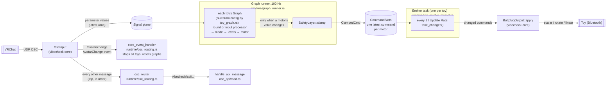

# Toy command path: OSC message → toy motor

How an avatar parameter from VRChat ends up as a Bluetooth command, while VibeCheck is on.

## Step by step

1. **`OscInput`** (`vibecheck-core/src/modules/osc.rs`) receives OSC from VRChat and unpacks bundles. Every parameter value is written to the session's **signal plane**, which keeps only the latest value per address. `/avatar/change` becomes an `AvatarChange` event. Every other message is also passed, in order, to the OSC router through the input's *tap*.
2. **OSC router** (`osc_routing.rs`) handles VibeCheck OSC API messages (`/avatar/parameters/vibecheck/api/...`). Nothing else needs routing (see [Routing](#routing)).
3. **Graph runner** (`graph_runner.rs`) ticks every toy's [graph](#the-graph) 100 times a second. Each tick reads the latest values from the signal plane, runs the chains, and for every motor whose value changed, passes it through `SafetyLayer::clamp` into the toy's `CommandSlots`.
4. **Emitter task** (`toy_emitter_thread.rs`) wakes at the toy's Update Rate, takes every command that changed since its last run, drops any the safety layer no longer `admits` (a panic since it was made), and hands the rest to `ButtplugOutput::apply`, which sends one Buttplug command per motor.

## The graph

Each toy's `Graph` is built from its config by `build_toy_graph` (`runtime/toy_graph.rs`). For every **enabled** feature (motor) it adds one chain per source:

| Source | Chain |
|---|---|
| Each OSC parameter (`osc/<address>`) | round → mode → levels → motor |
| The feature's input processor (SPS/TPS), if it has one | input processor → mode → levels → motor |

- **input processor** (`InputProcessorNode`): see [Input processors](#input-processors).
- **round** (`OscRounding`): rounds floats to hundredths as `f32`, exactly as VibeCheck always has (see [Values](#values)).
- **mode**: the parameter's (or input processor's) processing mode, from `vibecheck-core` `modules::modes`, built with the feature's Smooth Level, Rate Level, Constant Level and Flip Input.
- **levels**: `OutputLevels` from `modules::levels`: exactly 0 becomes Idle Speed, anything else is clamped to the Range. Flip Input is **not** applied in the graph (see [Master intensity and Flip Input](#master-intensity-and-flip-input)).
- **motor**: a sink to the motor's port, with Linear Speed as the duration for Linear features.

Rules:

- Only the **first** parameter with a given address counts within a feature.
- Disabled features get no chains.
- Input processor chains come before parameter chains, so if both change in the same tick the parameter's value is the one sent.
- Nothing is sent before a source has a value, so Idle Speed only starts after the first input.
- A chain only sends when its result **changes**. A steady value costs nothing; time-based modes (Smooth catching up, Rate winding down) send while they move.

The graph is built when the toy starts, so saved modes apply straight away, and **rebuilt on every config change**, which resets processor state (Smooth's window, Rate's level). A rebuilt graph reads the current values straight away, so a new Range or mode applies immediately rather than waiting for the next OSC message.

### Fixed tick

Processors run on the graph's 100 Hz tick, reading the latest value, rather than once per OSC message. This keeps behaviour independent of how often VRChat sends, and lets values change on their own over time:

| Mode | On the fixed tick |
|---|---|
| Raw, Constant | Unchanged |
| Smooth | Averages over a **time window** of `0.25 s × Smooth Level^0.7` (about 0.25 s at Level 1, 0.4 s at 2, 0.75 s at 5, 1.25 s at 10 and 2 s at 20). It used to average the last N messages, so it depended on VRChat's send rate. 0 still passes straight through and restarts the average |
| Rate | Movement since the last tick raises the level; it decays by **Rate Level per 150 ms, every tick**. It used to decay only when a new message arrived, so it could stay stuck at its last level when the input stopped moving |

The curve is `smooth_window` (`toy_graph.rs`), set by `SMOOTH_BASE_SECONDS` and `SMOOTH_CURVE`. It was tuned on hardware: a straight 50 ms, then 100 ms per level felt too jumpy at low levels, so low levels now get relatively more smoothing while the top stays around 2 s.

If a value changes more than once within one 10 ms tick, only the last one is seen.

### Several sources on one motor

When a motor has several chains (several parameters, or an input processor plus parameters), the chain whose value changed most recently decides the motor's level, much like "the latest message wins" before. One difference: a Rate chain winding down keeps changing, so it keeps sending until it reaches rest, even if another chain changed more recently.

### Input processors

An input processor (`toy_handling/input_processor/mod.rs`) turns a family of OSC parameters into one motor level, including parameters that aren't known until the avatar sends them (one set per SPS socket, for example). SPS and TPS are input processors. A feature picks one under **Processor > System**.

Each one runs inside the toy's graph as an `InputProcessorNode`, which:

1. **watches** the processor's address prefixes (`InputProcessor::prefixes`, e.g. `/avatar/parameters/OGB/`) on the signal plane, through the core's `Watch` (see [vibecheck-core](vibecheck-core.md#watching-ports)). Nothing has to be wired per parameter;
2. each tick, passes every watched parameter that changed since the last tick through the feature's **input filter** tags (`InputProcessor::input_filter`, by default "the address contains a tag"; no tags lets everything through) and gives the rest to `InputProcessor::update`, oldest change first;
3. calls `InputProcessor::tick(dt)`; a returned level goes on to the chain's mode, `None` leaves the motor as it is.

Input processors get values as VRChat sent them: they skip the `f32` rounding plain parameters get. Like every node, a processor is built anew when the toy's config changes, so any state it keeps starts over then. On avatar change, `InputProcessor::reset` is called instead (see [Avatar change](#avatar-change)). A processor is told whether its feature is Linear when it's created (`PenetrationSystemType::processor`).

To add one: implement `InputProcessor`, add a variant to `PenetrationSystemType`, and return it from `PenetrationSystemType::processor`. The frontend lists the variants through the generated `PenetrationSystemType` binding.

**SPS** (`penetration_systems/sps/`) reads every SPS zone the avatar has, under `OGB/` and newer VRCFury's `VFH/Zone/`, in both the legacy (Pen/Orf) and SPS3 (Plug/Socket) formats:

| Reading | Legacy | SPS3 |
|---|---|---|
| Depth on a socket | Root/tip depth with a learned plug length (`length.rs`), else `PenSelf`/`PenOthers` (`PenOthers` gated by `PenOthersClose` if sent) | 1 − separation / plug length. The length comes from a native SPS3 plug (collision tag + `SenderLossyScaleZ`), or is estimated for a legacy plug from `DepthRadius` |
| Depth on a plug | `PenSelf`/`PenOthers` | 1 − separation / (`LengthMult1` × `LengthMult2`) |
| Touch and frot | Proximity, gated by the `…Close` flag (except frot on sockets) | Proximity |

- **Touch speed:** where the avatar sends `<Contact>_SenderVelocityMagnitude`, touch and frot use that speed instead of the proximity, with 1 m/s as full power.
- **Combining:** the feature's level is the strongest reading of any zone that passes the input filter. Input filter tags match the zone's name (e.g. a socket's menu label), not the whole address.
- **Linear features** follow depth only.
- **`OGB/HapticsDisabled`** set by the avatar holds the level at 0 (which Idle Speed then applies to) until it's cleared.
- **Learning per tick:** root/tip and separation readings are taken once per tick, so values VRChat sends together are used together. The learned length is the median of recent readings.
- **Not ready yet:** nothing is sent until the first SPS value arrives.

**TPS** (`penetration_systems/tps/mod.rs`) reads `TPS_Internal/<Type>/<Id>/…`:

- **Depth:** an orifice's `Depth_In` and a penetrator's `RootRoot` are already depths from 0 to 1, and are used as they are. As before, either name is accepted whatever the type.
- **Combining:** each orifice and penetrator is tracked separately and the feature follows the deepest one. Before, the latest message won, so two TPS zones fought over the motor.
- **Input filter:** tags don't apply to TPS, as before.
- **Not ready yet:** nothing is sent until the first depth arrives.
- **Avatar change:** `reset` forgets every depth.

## Routing

Nothing needs routing to toys: `OscInput` writes every parameter value to the signal plane, and each toy's graph reads what it uses from there, including input processors, which watch their prefixes. The router only handles the OSC API.

## Avatar change

When `/avatar/change` arrives, `OscInput` first clears every OSC value from the signal plane, before reading the next message. VRChat sends the new avatar's values right after the change, so clearing anywhere later would wipe some of them too. Then it publishes an `AvatarChange` event (with the avatar id) on the event plane, and `core_event_handler` (`osc_routing.rs`):

1. starts the OSCQuery lookup (below);
2. stops every device. It builds the Buttplug stop command while holding the global state lock, releases the lock, and only then waits for Buttplug. A failed stop is logged;
3. tells the graph runner to reset every toy's graph (`GraphControl::ResetAll` → `Graph::reset`). Every processor forgets its state (Smooth's window, Rate's level, SPS zones and learned lengths, via `InputProcessor::reset`), and each motor forgets the last level it sent, so the new avatar's first value is sent even if it equals the old one. Watching nodes are given every value still on the plane again, so values the new avatar sent before the reset ran aren't lost. The reset comes after the stop, or the stop could silence the replayed values.

### Values VRChat never sends

VRChat only sends a parameter over OSC when it changes. Some are set once when the avatar loads and never change, such as an SPS plug's `LengthMult2` and a socket's `DepthRadius`. If one sits at its default, it never arrives, and it's also missed if VibeCheck starts after the avatar loaded.

`AvatarQuery` (`osc/avatar_query.rs`) reads them from VRChat's OSCQuery server, which reports every parameter's current value:

- **When:** once when the OSC socket is bound, and 1, 4 and 10 s after each avatar change (VRChat may still be loading). A lookup still running for the previous avatar writes nothing.
- **Finding VRChat:** mDNS, looking for a `VRChat-Client-…` `_oscjson._tcp` service for up to 3 s. The address is remembered until a request fails.
- **What:** `GET /avatar/parameters`. Only addresses `is_setting_address` accepts are used (SPS `LengthMult1`, `LengthMult2`, `DepthRadius`), so plain parameters don't start Idle Speed at avatar load.
- **How:** `SignalPlane::write_if_absent`, as if the value arrived over OSC, but never over a value VRChat already sent.

SPS treats these settings as not being contact, so they don't make the processor start sending (and Idle Speed start) on their own.

## OSC API

`/avatar/parameters/vibecheck/api/...` messages go to `handle_api_message` (`osc_api/mod.rs`). They never reach toys. The router runs the handler with `block_in_place`, because it locks the global state and may save config, so API messages are handled in arrival order without stalling the async workers.

`/avatar/parameters/vibecheck/state` (turn on) is not on this path: it's handled by the listener that runs while VibeCheck is **off** (`vc_disabled_osc_command_listen` in `osc/logic.rs`).

## Session lifetime

Turning VibeCheck on creates a `Session` (`toy_management_handler.rs`): a tokio runtime, a signal plane, an event plane and the graph runner. On it run the core event handler, the graph runner, `OscInput`, the router, and one task plus one emitter per toy. Everything in the session publishes on the same event plane: `OscInput` (avatar change), graph processors, and each toy's output (errors). Turning off (or a reset) aborts the toy tasks and shuts the runtime down, which closes the OSC socket and frees the port for the "off" listener.

If the port can't be bound, `OscInput::bind` fails, the error is logged, and `TmSig::BindError` is sent.

## One slot per motor

`CommandSlots` keeps **one latest command per motor**. Between two emitter runs:

- Two commands for the **same** motor: only the newest is sent.
- Commands for **different** motors on the same toy: all of them are sent.

This replaced a single `watch` channel per toy, which held one value for the whole toy, so when one parameter drove several motors only the last was ever commanded.

## Names

Commands and signals are addressed with stable names rather than Buttplug device indexes, which change between sessions.

| Thing | Format | Example | Made by |
|---|---|---|---|
| Toy (module instance) | `toy:{name}:{sub_id}` | `toy:lovense_edge:0` | `toy_module_id` |
| Motor (port) | `{FeatureType}_{feature_index}` | `Vibrator_1`, `Linear_0` | `feature_port_name` |
| OSC parameter value | `osc/<address>` | `osc//avatar/parameters/Boop` | `OscInput` |
| Graph nodes | `toy:…/<Motor>/param<i>/{round,mode,levels}`, `toy:…/<Motor>/input_processor`, `toy:…/<Motor>/input_processor/{mode,levels}` | `toy:lovense_edge:0/Vibrator_1/param0/mode` | `build_toy_graph` |

- The toy name is lowercase with spaces turned into underscores, the same as the OSC battery address.
- Scalar features (vibrate, constrict, oscillate, inflate, position, scalar rotate) share one index space; rotators and linears each have their own (see [Feature type → Buttplug command](#feature-type--buttplug-command)). So type plus index is unique within a toy.

## Feature type → Buttplug command

VibeCheck uses Buttplug's version 12 release (message spec v4), where a device is a list of numbered **features**, each with **outputs** such as vibrate, rotate or position-with-duration. VibeCheck's toy configs predate that and number features the spec v3 way: scalars, rotators and linears each counted from 0. `LegacyLayout` (`vibecheck-core` `modules::buttplug`) rebuilds that numbering from the device's features, matching how Buttplug 9 listed devices, so saved configs keep matching their toys:

- **scalars**: every vibrate, rotate, oscillate, constrict and position output, in feature order, except rotators that can turn both ways. Temperature, LED and spray outputs are skipped;
- **rotators**: features whose rotate output can turn both ways;
- **linears**: features with a position-with-duration output.

A rotate feature is a scalar *or* a rotator, never both. In Buttplug 9 every rotating device's rotate features were either scalar-only or rotate-only, and the rotate-only ones are exactly those Buttplug 12 lets turn both ways (checked device by device across both versions' device lists). Buttplug 12's own v3 compatibility layer lists two-way rotators as scalars too; following it made toys like the Lovense Nora show their rotator twice.

The layout is worked out when a toy connects (`VCToy.layout`). A feature then becomes an `Actuator` (`actuator_for` in `toy_output.rs`):

| `VCFeatureType` | Looked up in | `Actuator` | Sent as |
|---|---|---|---|
| Vibrator, Oscillate, Constrict, Position, ScalarRotator, Inflate | scalars | `Level { feature, output }` | that output, at the level |
| Rotator | rotators | `Level { feature, output: Rotate }` | rotate, at the level (always clockwise) |
| Linear | linears | `Position { feature }` | position with duration (position = level, duration = Linear Speed) |

The output type comes from the device, not from the config, so a config's feature type is only a label. Inflate isn't an output type any more; old configs that have it still work, as whatever the device reports at that scalar index. A feature the toy doesn't have (e.g. a config saved for a different model) is logged and gets no port.

Levels are sent as a percentage of the output's steps; Buttplug rounds up to the next step, as before. When a toy connects, its config is only reused if it has the same number of scalars, rotators and linears as the toy; otherwise the features are repopulated.

## Config changes and update rate

- `alter_toy` from the frontend reaches the toy management handler, which builds a fresh graph from the new config (input processors included) and hands it to the runner, and sends the new config down the toy task's **control channel**, which updates the toy's output (Flip Input) and emitter.
- If the Update Rate changed, the toy task sends `ToyEmitterThreadSignal::UpdateRate` to the emitter.
- When a toy is removed (it disconnected), its graph is removed from the runner and its task is aborted. The emitter exits when its channel closes (or on `StopExecution`, if the task ends on its own). Turning VibeCheck off does the same for every toy.

## Errors

- `ButtplugOutput::apply` tries every command even if one fails, and returns the first error. The emitter logs it (`Send to device error: ...`).
- Each toy's `ButtplugOutput` also publishes an `OutputError` event when sending starts failing and when it works again. The core event handler logs these (`toy:… is failing: …` / `toy:… is working again`). Nothing reacts to them yet; the safety layer will (e.g. disarming risky outputs that stop responding).
- If a toy's graph can't be built (a wiring bug), the error is logged and that toy gets no new graph.

## Not on this path

- **The Test button** (`simulate_device_feature` in `vcore/ipc/call_plane.rs`) calls `command_toy` (`toy_command_processor.rs`) directly. It skips the graph and the slots, but applies the same steps in the same order: Idle and Range (`OutputLevels`), then the master intensity (`SafetyLayer::limit`, using the app's shared safety layer), then Flip Input.

## Testing this path

[`osc-tool`](../../src-tauri/crates/osc-tool/README.md) sends OSC to VibeCheck as if VRChat sent it, so the whole path can be exercised without VRChat. VibeCheck can stay open while sending.

| To check | Run (from `src-tauri/`) | Expect |
|---|---|---|
| A parameter reaches the toy | `cargo run -p osc-tool -- send Boop 0.5` | The motor runs at 50%, or the nearest end of Range if 50% is outside it |
| Idle Speed | `send Boop 0.5`, then `send Boop 0` | The motor drops to Idle Speed, not off |
| Range and Smooth | `cargo run -p osc-tool -- sweep Boop 0 1 --seconds 3` | A steady ramp, capped at the top of Range; with Smooth, slightly behind the input |
| Rate mode | `cargo run -p osc-tool -- sweep Boop 0 1 --seconds 0.3 --back` | A burst that winds down after the stroke |
| Rate doesn't stick | Rate mode, then `send Boop 0.6` once and wait | A burst that winds down to Idle Speed on its own |
| Constant mode | `send Boop true`, then `send Boop false` | Constant Level, then Idle Speed (off if Idle Speed is 0) |
| Saved modes after a restart | Set a parameter to Constant, restart VibeCheck, then `send Boop true` without touching any setting | Constant Level straight away |
| One slot per motor | Map one parameter to two motors on one toy, then `sweep` it | Both motors follow the ramp |
| Avatar change stops toys | `send Boop 0.5`, then `cargo run -p osc-tool -- send /avatar/change s:avtr_test` | The toy stops, and changing a setting afterwards doesn't start it again |
| OSC API anatomy toggle | `cargo run -p osc-tool -- send vibecheck/api/anatomy/Vagina/enabled false` | Toys tagged Vagina are disabled (and the UI shows it) |
| Master intensity | `send Boop 1.0`, then set Settings > Toys > Master intensity to 50% | The motor drops to half straight away; with Flip Input on, it also gets weaker, not stronger |
| Panic stop | `sweep Boop 0 1 --seconds 5`, press **Stop all toys** (or Ctrl+Alt+P) mid-sweep | The toy stops at once and stays stopped while the sweep finishes; the sidebar shows "All toys stopped" |
| Panic from VRChat | `send vibecheck/api/panic true` | Same as the button; `send vibecheck/api/panic false` does **not** resume |
| Resume | Press **Resume**, then `send Boop 0.4` | Nothing happens until the new value arrives, then the toy runs at 0.4 |
| Config changes apply at once | `send Boop 0.8`, then lower the top of Range in the app | The motor drops to the new maximum straight away |

If the toy doesn't react, `osc-tool listen` (with VibeCheck closed) shows whether VRChat or the tool is reaching the port at all.

## Values

Levels are `f64` from the processors through to Buttplug, matching Buttplug's own type.

OSC floats arrive as `f32`. The graph's `OscRounding` node rounds them to hundredths while still `f32` and then widen to `f64`, so a parameter value of `0.85` reaches the modes as `0.8500000238…`. This is unchanged from before the migration. Input processors aren't rounded (see [Input processors](#input-processors)). Rounding after widening would give exact hundredths, but it could move some values onto a different Buttplug power step, so it should be its own deliberate change.

## Master intensity and Flip Input

**Master intensity** (Settings > Toys) scales every toy's level, keeping the full range: at 60%, full power becomes 60% and half power becomes 30%. It's saved as `master_intensity` in the app config (default 1.0; config files from before it existed load as 1.0).

- `VibeCheckState` holds one `SafetyLayer`, created with the saved intensity. Each session's graph runner and the Test button use clones of it, which share their caps.
- `set_vibecheck_config` saves the new intensity and calls `set_intensity` on that layer, so it applies straight away, including to toys already running.

**Flip Input** is applied last, by each toy's `ButtplugOutput` (`ActuatorSpec.flip`, set from the feature by `toy_actuators` in `toy_output.rs`). Everything before it, the graph and the safety layer, works in intensities where 0 is always off. That's what makes the master intensity correct for toys whose motors run backwards: capping before the flip limits their power, where capping after it would do the opposite. When a toy's config changes, the toy task sends the new mapping to its emitter (`ToyEmitterThreadSignal::UpdateActuators`).

At 100% intensity the order changes nothing: levels reach the toy exactly as before.

## Panic stop

Three ways in, all ending in `trigger_panic` (`vcore/panic.rs`):

| Trigger | Where |
|---|---|
| **Stop all toys** button, at the top of the sidebar | `panic_stop` command (`frontend_native.rs`) |
| Global hotkey **Ctrl+Alt+P** (`PANIC_HOTKEY`) | `register_panic_hotkey` (`main.rs`) |
| Avatar parameter `vibecheck/api/panic` set to true | `osc_api/mod.rs` (only while VibeCheck is on, like the rest of the OSC API) |

`trigger_panic`:

1. calls `panic()` on the app-wide safety layer: every new command is refused, every command already made is stale, everything is disarmed;
2. stops every device with Buttplug's stop-all, awaited without holding the state lock;
3. emits `FeCoreEvent::Safety(Panicked)`, so the sidebar shows "All toys stopped" with **Resume**.

That covers every path a level could take: graph sinks get `None` from `clamp`, commands already sitting in a toy's slots fail `admits` in the emitter, and the Test button's `limit` returns 0.

**Resume** (`panic_resume` → `resume_from_panic`) is only possible from the app, on purpose: neither the hotkey nor the OSC parameter can resume. After resuming, nothing is replayed: values that arrived during the panic count as already seen by each graph sink, so each motor waits for its next change. On load, the frontend asks `get_panic_state`, in case a panic happened before the window opened.

The hotkey is registered after the app is built, through `AppHandle::plugin`. If global shortcuts aren't available (e.g. under some Wayland setups) or the combo is taken, VibeCheck logs a warning and runs without the hotkey; the button and OSC parameter still work. Registering it in the plugin builder instead would make a failure stop the app from starting.

Outputs marked risky (none in the free app yet) are also disarmed by `core_event_handler` when they start failing (`OutputError`), so they must be re-armed on purpose once they're back.

### Other safety caps

The other caps are still at their defaults: max level 1.0, max duration 10 s, max event depth 3. Since levels are already within 0 to 1 and Linear Speed tops out at 1000 ms, their only practical effect today is that a non-finite level (NaN or infinity) becomes 0 instead of reaching the toy.
