# Toy command path: OSC message → toy motor

How an avatar parameter from VRChat ends up as a Bluetooth command, while VibeCheck is on.

```mermaid
flowchart LR
  VRC[["VRChat"]] -- "UDP OSC" --> UDP["OSC listener thread<br/>osc/logic.rs<br/>toy_input_routine"]

  UDP -- "broadcast ToySig::OSCMsg<br/>(every toy gets every message)" --> TT

  subgraph TT["Toy task (one per connected toy)<br/>runtime/toy_management_handler.rs"]
    direction TB
    PARSE["parse_osc_message<br/>osc_processor.rs<br/>SPS/TPS · Raw/Smooth/Rate/Constant"]
    SINK["ToyCommandSink::send<br/>runtime/toy_output.rs"]
    LT["clamp_and_flip<br/>Idle · Range · Flip Input"]
    SAFE["SafetyLayer::clamp<br/>(vibecheck-core)"]
    PARSE --> SINK --> LT --> SAFE
  end

  SAFE -- "ClampedCmd" --> SLOTS[("CommandSlots<br/>one latest command<br/>per motor")]

  subgraph EM["Emitter task (one per toy)<br/>runtime/toy_emitter_thread.rs"]
    TICK["every 1 / Update Rate:<br/>take_changed()"]
  end

  SLOTS --> TICK
  TICK -- "changed commands" --> BP["ButtplugOutput::apply<br/>(vibecheck-core)"]
  BP -- "scalar / rotate / linear" --> TOY[["Toy (Bluetooth)"]]
```

## Step by step

1. **OSC listener** (`osc/logic.rs`) receives every OSC message from VRChat and broadcasts it as `ToySig::OSCMsg` to every toy task.
2. **Toy task** (`toy_management_handler.rs`) runs `parse_osc_message` (`osc_processor.rs`) for each message. For every feature the message applies to, it runs the input processor (SPS/TPS) and/or the parameter's processing mode, which produces a level.
3. **`ToyCommandSink::send`** (`toy_output.rs`) takes that level and:
   1. applies the feature's level tweaks with `clamp_and_flip`: a level of exactly 0 becomes Idle Speed, anything else is clamped to the Range, then Flip Input is applied;
   2. for Linear features, attaches Linear Speed as the command's duration;
   3. passes it through `SafetyLayer::clamp`, which returns a `ClampedCmd`;
   4. writes it into the toy's `CommandSlots`.
4. **Emitter task** (`toy_emitter_thread.rs`) wakes at the toy's Update Rate, takes every command that changed since the last tick, and hands them to `ButtplugOutput::apply`, which sends one Buttplug command per motor.

## One slot per motor

`CommandSlots` keeps **one latest command per motor**. Within one tick:

- Two commands for the **same** motor: only the newest is sent.
- Commands for **different** motors on the same toy: all of them are sent.

This replaced a single `watch` channel per toy, which held one value for the whole toy. When one parameter drove several motors, each write overwrote the previous one before the emitter ticked, so only the last motor was ever commanded.

Writing the same value twice still counts as a change, so it is sent again, as before.

## Names

Commands are addressed with stable names rather than Buttplug device indexes, which change between sessions.

| Thing | Format | Example | Made by |
|---|---|---|---|
| Toy (module instance) | `toy:{name}:{sub_id}` | `toy:lovense_edge:0` | `toy_module_id` |
| Motor (port) | `{FeatureType}_{feature_index}` | `Vibrator_1`, `Linear_0` | `feature_port_name` |

- The toy name is lowercase with spaces turned into underscores, the same as the OSC battery address.
- Scalar features (vibrate, constrict, oscillate, inflate, position, scalar rotate) share one index space; rotators and linears each have their own. So type plus index is unique within a toy.

## Feature type → Buttplug command

| `VCFeatureType` | `Actuator` | Buttplug call |
|---|---|---|
| Vibrator | `Scalar` + `Vibrate` | `scalar` |
| Oscillate | `Scalar` + `Oscillate` | `scalar` |
| Constrict | `Scalar` + `Constrict` | `scalar` |
| Inflate | `Scalar` + `Inflate` | `scalar` |
| Position | `Scalar` + `Position` | `scalar` |
| ScalarRotator | `Scalar` + `Rotate` | `scalar` |
| Rotator | `Rotate` | `rotate` (always clockwise) |
| Linear | `Linear` | `linear` (duration = Linear Speed, position = level) |

The mapping lives in `actuator_for` (`toy_output.rs`).

## Config changes and update rate

- `alter_toy` from the frontend reaches the toy task as `ToySig::UpdateToy` on the same broadcast channel as OSC messages. The task replaces its feature config; the next level it processes uses the new settings.
- If the Update Rate changed, the toy task sends `ToyEmitterThreadSignal::UpdateRate` to the emitter.
- When the toy disconnects or VibeCheck turns off, the toy task sends `StopExecution` and the emitter exits.

## Errors

`ButtplugOutput::apply` tries every command even if one fails, and returns the first error. The emitter logs it (`Send to device error: ...`).

## Not on this path

- **The Test button** (`simulate_device_feature` in `vcore/ipc/call_plane.rs`) calls `command_toy` (`toy_command_processor.rs`) directly. It skips the slots and the safety layer.

## Values

Levels are `f64` from the processors through to Buttplug, matching Buttplug's own type, so the core adds no conversions of its own.

OSC floats arrive as `f32`. `parse_osc_message` rounds them to hundredths while still `f32` and then widens to `f64` (`((lvl * 100.0).round() / 100.0) as f64`), so a parameter value of `0.85` reaches the processors as `0.8500000238…`. This is unchanged from before the migration. Rounding after widening would give exact hundredths, but it could move some values onto a different Buttplug power step, so it should be its own deliberate change.

## Safety caps today

The toy task uses `SafetyLayer::default()`: max level 1.0, max duration 10 s, max event depth 3. Since `clamp_and_flip` already keeps levels within 0 to 1 and Linear Speed tops out at 1000 ms, the only practical effect today is that a non-finite level (NaN or infinity) becomes 0 instead of reaching the toy. User-set caps will make this meaningful.
